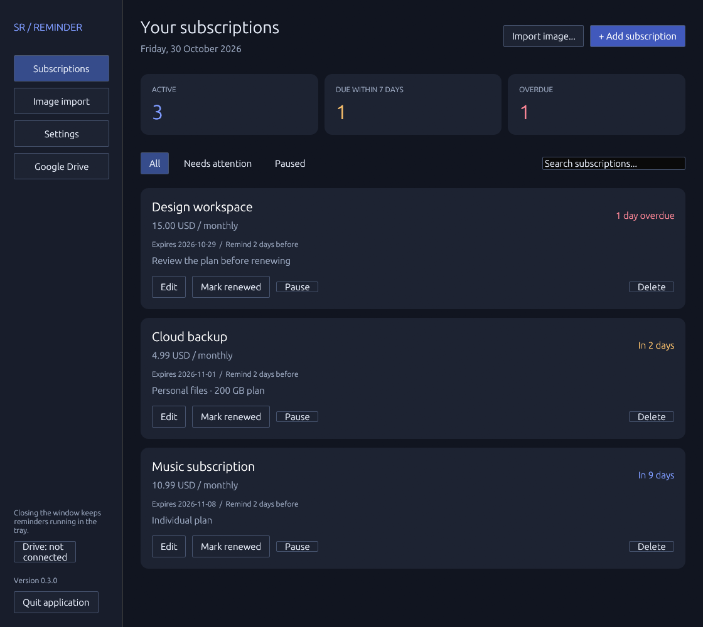
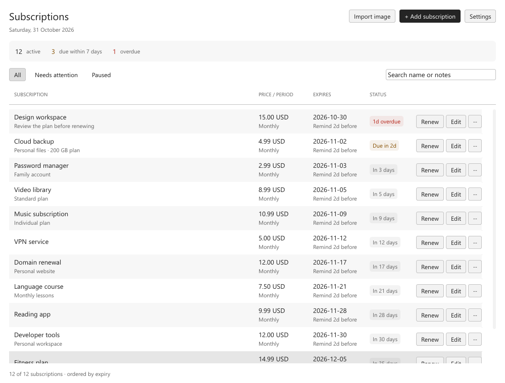
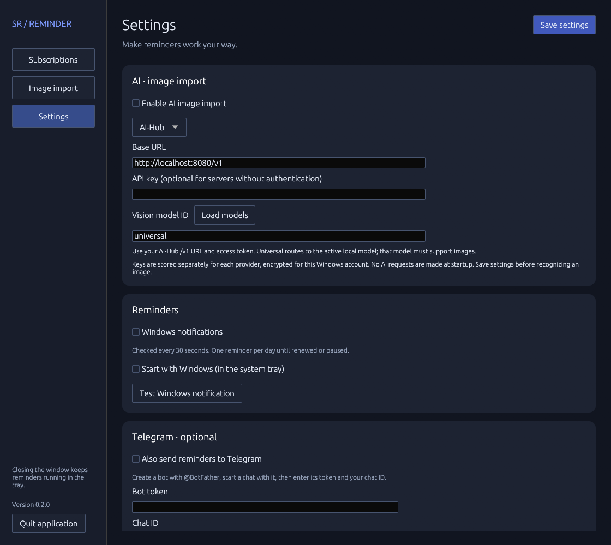
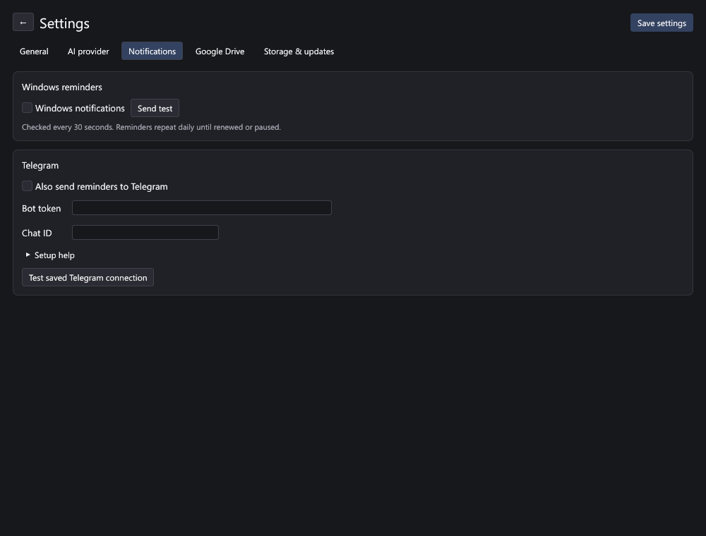
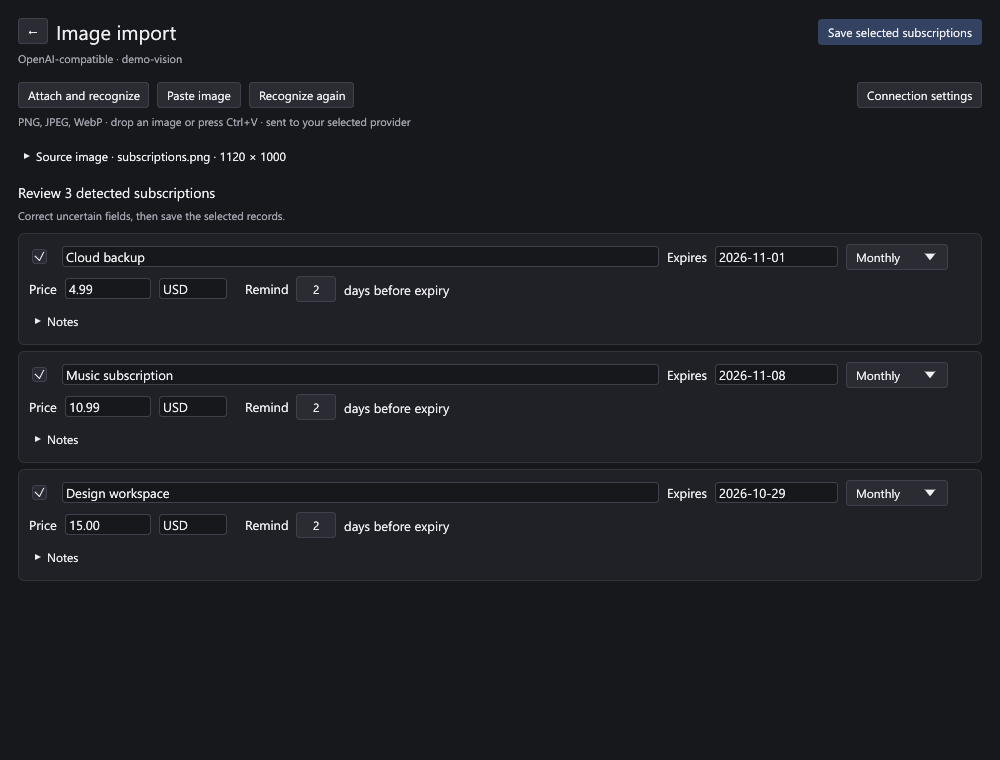
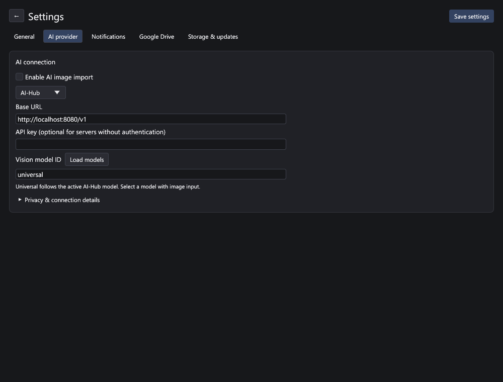
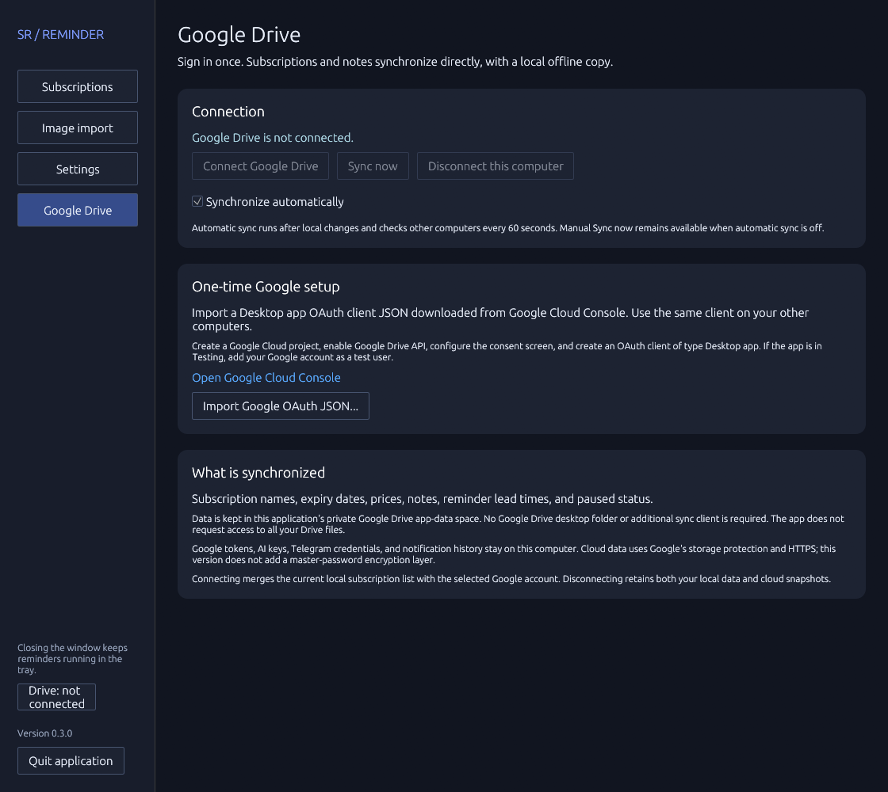
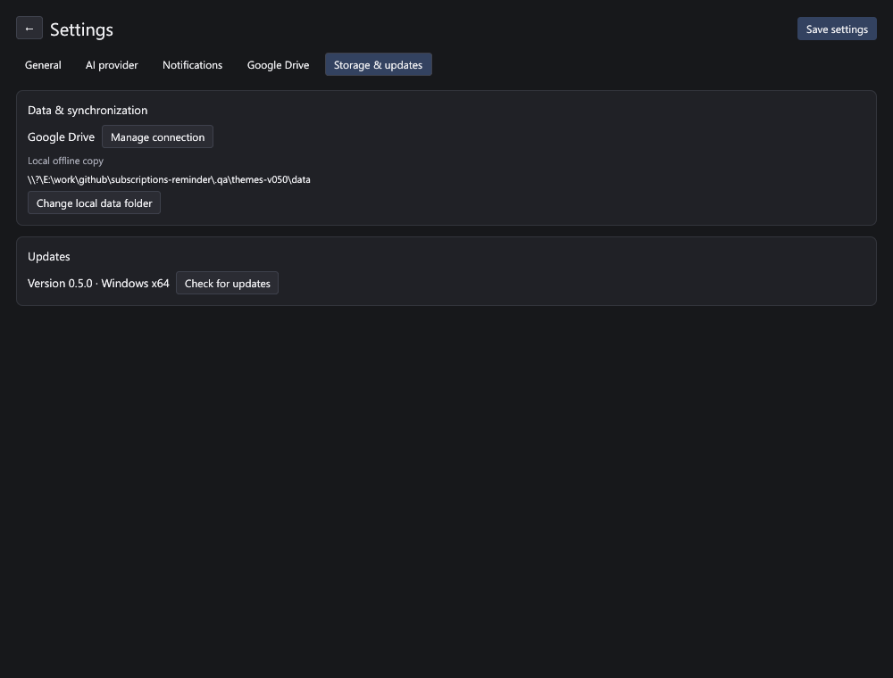

# Subscriptions Reminder

A small Rust desktop app that keeps subscription expiry dates out of your head. Add subscriptions and notes by hand or import them from a screenshot using your own AI connection. Receive Windows reminders before they expire; Telegram is optional.

**Windows 10/11 · x64 · one executable · no installer, WebView, or Rust runtime required**

[Download the latest release](https://github.com/siarheisinelnikau/subscriptions-reminder/releases/latest)



## Features

- Create, edit, search, pause, and delete subscriptions with notes and optional prices.
- Attach, drop, or paste a screenshot to recognize subscriptions with AI-Hub, OpenRouter, or another OpenAI-compatible vision endpoint.
- Review and edit detected dates, prices, currency, billing periods, and notes, then save selected records together. Exact duplicates are skipped.
- Choose how many days before expiry to be reminded; the default is two days.
- Track monthly, quarterly, yearly, weekly, and one-time subscriptions.
- Mark a subscription renewed to advance its expiry date by one billing period.
- Receive Windows notifications while the main window is hidden in the tray.
- Optionally send reminders through your own Telegram bot.
- Sign in to Google Drive in your browser and synchronize directly, with an offline local copy and conflict review.
- Check for updates and download, verify, install, and restart from Settings.
- Render on the CPU and present through Windows GDI, with event-driven redraws and no OpenGL or DirectX context.
- Choose a neutral Light or Dark theme, or follow Windows with System mode.

## Compact workspace

Subscriptions use rows with notes, pricing, expiry, status, and actions aligned in columns. At the default 1000 × 760 window size, ten complete subscriptions fit above the fold in Compact mode. Long names and notes are truncated in the table and available on hover or through **Edit**. **Renew** stays directly accessible; the row menu contains Pause/Resume and Delete. Large lists render only visible rows.

Settings are divided into **General**, **AI provider**, **Notifications**, **Google Drive**, and **Storage & updates**. Appearance choices save immediately; other editable settings use **Save settings**.

## Getting started

1. Download `SubscriptionsReminder-v0.5.0.exe` from [Releases](https://github.com/siarheisinelnikau/subscriptions-reminder/releases).
2. Put it in a writable folder where you plan to keep it, then launch it.
3. Click **Add subscription**. Enter its name, expiry date (`YYYY-MM-DD`), and reminder lead time.
4. In **Settings → General**, optionally enable **Start with Windows**. Closing the window keeps the app running; use the tray icon or launch the EXE again to reopen it. **Quit application** in General or the tray menu stops reminders.

The app checks reminder eligibility every 30 seconds. Each enabled channel receives at most one successful reminder per subscription, expiry date, and local calendar day. Reminders repeat daily until you renew, pause, or delete the subscription. If the app starts late, it includes overdue subscriptions. Windows may suppress notifications through Do Not Disturb or notification settings.

The computer must be on, you must be signed in, and the app must be running for either channel to deliver. This is a desktop reminder app, not a cloud scheduling service.

**Renew** advances one billing period from the later of the current expiry date or today. Month-end dates clamp to the last valid day of the next period. For a custom date or a one-time subscription, use **Edit**.

## Appearance

Open **Settings → General → Appearance** and choose **System**, **Dark**, or **Light**. The choice applies immediately and is saved on this computer without clicking Save settings. System is the default and follows Windows app appearance through native theme-change events. Theme changes do not change subscriptions or cloud data.

The dark palette and typography follow Multi-Monitor Brightness, with Segoe UI at 13 px for body text and 12 px for buttons; the light palette uses white and gray surfaces with contrasting text and status colors. Both themes cover the subscription table, settings, image import, dialogs, and Google Drive screen. The native title bar follows the selected appearance too.

**Subscription size** offers **Compact**, **Standard**, and **Large** rows with 48, 64, and 80 logical pixels of height. The choice changes spacing while retaining the readable text size, applies immediately, and is saved locally. Compact is the default for existing and new settings without a saved size.



## Settings and Telegram



Create a bot with [@BotFather](https://t.me/BotFather), open the bot's chat, and send `/start`. Open **Settings → Notifications**, enter the bot token and your chat ID, enable Telegram, and click **Save settings**. **Test saved Telegram connection** sends a test message. You can obtain the chat ID from the bot's `getUpdates` response after messaging it; keep the token private and do not paste it into public tools or issues.

Telegram is disabled by default. When enabled, subscription names and expiry dates are sent to the Telegram Bot API over HTTPS. Notes are not sent. The bot token is encrypted with Windows DPAPI for the current Windows account and saved in local settings, outside the synced data folder.



## Import subscriptions from a screenshot

1. Open **Settings → AI provider**, enable **AI image import**, and choose a provider.
2. Enter its Base URL, API key if required, and a vision-capable model ID. **Load models** can retrieve IDs from the service. Click **Save settings** at the top.
3. Open **Image import** and click **Attach and recognize** or **Paste image**. You can also drop an image into the application, or use **Ctrl+V** on the import page while no text field is focused.
4. Review the detected subscriptions. Correct any uncertain fields, deselect unwanted entries, and click **Save selected subscriptions**.





| Provider | Base URL | Model |
| --- | --- | --- |
| AI-Hub | `http://YOUR-HUB-HOST:8080/v1` | `universal` |
| OpenRouter | `https://openrouter.ai/api/v1` | A model ID with image input |
| OpenAI-compatible | Your service's API root, usually ending in `/v1` | A vision-capable model ID |

AI-Hub's `universal` alias follows its active local model; that model must support images. Its API key is the private AI-Hub access token. Use HTTPS outside a trusted local network. Each provider has its own saved URL, model, and encrypted key. Changing an endpoint clears that profile's key to prevent sending a credential to a different service.

Image import uses the standard Chat Completions endpoint with an inline base64 image. PNG, JPEG, and WebP files up to 20 MB are supported. Large images are resized to at most 2560 pixels on the longest side and re-encoded without source metadata. The app sends the selected image, an extraction prompt, and today's date to the selected provider when you attach, drop, paste, or explicitly recognize it. It does not send the existing subscription list, follow links in the image, or make AI requests on startup. API usage may be billed by the provider.

Dates that are not visible remain unresolved and must be entered before saving. The model's notes explain uncertainty. All selected records are validated before a single data-file save; invalid selected records prevent a partial import. Records with the same name and expiry date as an existing entry are skipped. Images are not copied to the subscription data folder.

## Google Drive synchronization



Google Drive is connected directly through the Drive API. The application includes its Desktop OAuth client, so ordinary connection does not require a Google Cloud project or a downloaded configuration file. You do not need Drive for desktop, a mounted Drive folder, or another sync application.

1. Open **Settings → Google Drive**.
2. Click **Connect Google Drive**. Finish sign-in and grant the requested app-data permission in your system browser.
3. Return to the app. Your current local subscriptions merge with the selected Google account. **Synchronize automatically** is enabled by default.
4. On another computer, use the same application release and sign in to the same Google account.

The bundled Google project is currently in **Testing**, so sign-in is limited to its registered test users. Google may require reconnection after seven days. Registration and any production verification belong to the application maintainer, not each end user. Developers can still import their own Desktop client under **Advanced: custom Google connection**; see the [maintainer and custom-client guide](docs/google-drive-setup.md).

Local changes are uploaded after a short debounce; other devices are checked every 60 seconds. **Sync now** starts an immediate round. Disabling automatic synchronization prevents future background sync and token-refresh requests; manual syncing remains available. An in-flight request may finish when paused or disconnected. Synchronization runs independently of window rendering.

Independent subscription changes merge automatically. Concurrent changes to the same subscription, including edit-versus-delete, retain their versions under **Review conflicts**. Choose a version or keep all subscription versions as separate records. Deleted records retain synchronization tombstones, so an old device snapshot does not restore them. Credentials and notification history are device-local.

The app uses Google's private `appDataFolder` and the `drive.appdata` scope, not permission to all Drive files. Each installation writes its own snapshot and reads peer snapshots, so simultaneous device uploads do not replace each other's files. Sync data includes subscriptions, notes, dates, prices, reminder lead times, paused state, and revision metadata. It does **not** include AI keys, Telegram credentials, Google tokens, or attached source images. Google tokens are encrypted locally with Windows DPAPI. Transfer uses HTTPS and Google's storage protection; this release does not add master-password encryption to cloud data.

Offline edits stay local and are retried with backoff. Expired or revoked sessions request reconnection without deleting local data. **Disconnect this computer** stops using its saved Google session while retaining local data and cloud snapshots. Revoke access through your Google Account's connected-app controls if needed.

Use a separate private settings directory for each installation. Do not copy its Google credentials or `drive` checkpoint directory between computers; connect each independently. Sync payloads are limited to 8 MB, and checkpoints retain causal history and deletions.

## Local storage

Settings live in `%LOCALAPPDATA%\SubscriptionsReminder\settings.json`. By default, subscription data lives in `%LOCALAPPDATA%\SubscriptionsReminder\data\subscriptions.json`.

The local copy remains available offline. **Settings → Google Drive** contains the account connection; **Storage & updates** shows the local offline copy. **Change local data folder** is an advanced option available while Drive is disconnected; it is not needed for cloud synchronization. An existing `subscriptions.json` is loaded without overwriting it; an empty folder receives a copy of the current list. The old folder is retained.



Data saves use a temporary file, atomic replacement, and a `.json.bak` copy of the previous file. Invalid or externally changed data is not silently overwritten. External changes are checked in the background. Local subscription files and backups are plain JSON. Google Drive replication checkpoints live in the private settings directory's `drive` subdirectory, outside the selected data folder.

If a JSON file becomes invalid, close the application, keep a copy of the damaged file, and restore the matching `.json.bak` file. The app reports the affected path instead of resetting your data. A missing data file on later launches is reported as unavailable, which prevents an offline sync folder from silently becoming an empty store.

## Updates

Startup update checks are configured under **Settings → General** and enabled by default and do not block launch. Disable **Check for updates on startup** and save Settings to prevent update requests on future launches. Manual **Check for updates** remains available. Startup checks only show a banner when a newer compatible stable release exists.

**Download and install** downloads the official Windows x64 release asset, checks its size and published SHA-256 checksum, and starts a temporary helper to replace the EXE after the app exits. Settings and subscriptions stay in their existing folders. The updated application restarts. Downloads never start automatically. The app folder must be writable. The portable EXE retains its existing path when updated, so shortcuts keep working.

## Development

Install Rust and the MSVC C++ build tools on Windows. CI uses Rust 1.96.1; the package declares Rust 1.88 as its minimum.

```powershell
cargo test --locked
cargo clippy --locked --all-targets -- -D warnings
cargo build --release --locked
./scripts/package.ps1
```

The packaged EXE and `SHA256SUMS.txt` appear in `dist/`. The MSVC C runtime is statically linked. The GUI uses egui with CPU rasterization and Windows GDI bitmap presentation. Idle windows wait for events; unchanged scenes skip rasterization and presentation. Hidden and minimized windows process commands without painting. Input-driven frames are coalesced at up to 60 FPS; this is a ceiling, not a continuous render loop. Reminder and synchronization workers run independently.

For isolated UI testing, use a separate local settings directory:

```powershell
./dist/SubscriptionsReminder-v0.5.0.exe --data-dir ./target/manual-test --demo
```

`--demo` inserts twelve sample subscriptions into an empty data store and disables automatic update checks and reminder notifications for that demo store. `--background` starts with the main window hidden. Instances share one window and monitor per settings directory.

The opt-in native desktop regressions exercise the packaged EXE, actual window handles, and tray callback dispatch on an interactive Windows desktop:

```powershell
$env:SUBSCRIPTIONS_GUI_EXE = (Resolve-Path ./dist/SubscriptionsReminder-v0.5.0.exe).Path
cargo test --locked --test desktop -- --ignored --nocapture --test-threads=1
```

Set `SUBSCRIPTIONS_RENDER_TRACE` to a local JSONL file to collect frame timings and counts. Batches are written outside the UI thread and contain performance measurements only. Tracing is disabled by default.

`--image PATH` opens an image in the import view. Add `--recognize` to start recognition using the saved AI connection. For cursor-free documentation screenshots, `--capture-dir PATH` captures the actual subscription table, all five Settings tabs, image import, and the subscription editor, then exits. When recognition is active, the import capture waits for its result and saves a local `recognition.json` report alongside the PNGs.

The Windows workflow checks formatting, runs tests and Clippy, builds the EXE, and packages checksums. On `main`, a package version without a published release is published with `docs/releases/vVERSION.md` as its description. Existing published releases are never modified. Review and update the release notes before increasing the package version.

## License

MIT.

## Shared updater source

Build with Rust 1.95 or newer. Keep `rust-auto-updator` beside this repository: the core path dependency is `../rust-auto-updator/crates/rust-auto-updator`. The shared core handles canonical release selection, throttled progress, SHA-256 and PE verification, same-volume replacement, rollback and cleanup. This application owns the saved startup preference, its Updates UI and `--data-dir` restart arguments. Downloads/installations still require the user's action. Earlier releases copy their own executable as the legacy helper, so their helper can install this new executable normally.

A standalone checkout and current hosted CI require that sibling source to be provisioned first. The dependency is not published or fetched from a guessed remote. GUI/tray integration and subjective input latency are separate from noninteractive diagnostic evidence.

For a finite isolated CPU/GDI idle, minimize, restore and hidden diagnostic (no OS input):

```powershell
.\target\release\subscriptions-reminder.exe --demo --data-dir .qa\rendering-data --diagnostics .qa\rendering.json
```

The process exits after about 17 seconds and records actual layout/raster/present counters plus process CPU time. The normal app does not run this diagnostic schedule. Native icon-resource proof is available through `scripts/Check-Icons.py`; its PNG renders the embedded EXE icons with Win32, not a screenshot of the OS tray.
