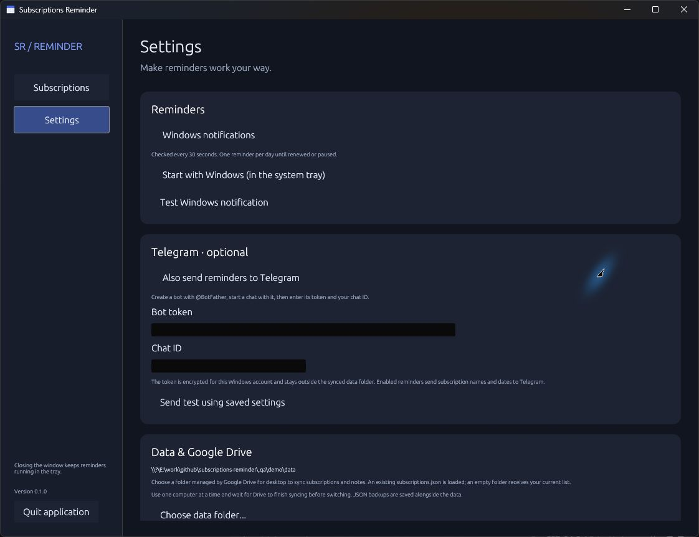

# Subscriptions Reminder

A small Rust desktop app that keeps subscription expiry dates out of your head. Add your subscriptions and notes, and receive Windows reminders before they expire. Telegram is optional.

**Windows 10/11 · x64 · one executable · no installer, WebView, or Rust runtime required**

[Download the latest release](https://github.com/siarheisinelnikau/subscriptions-reminder/releases/latest)

The dashboard screenshot is pending a final interactive verification pass. A real settings preview is included below.

## Features

- Create, edit, search, pause, and delete subscriptions with notes and optional prices.
- Choose how many days before expiry to be reminded; the default is two days.
- Track monthly, quarterly, yearly, weekly, and one-time subscriptions.
- Mark a subscription renewed to advance its expiry date by one billing period.
- Receive Windows notifications while the main window is hidden in the tray.
- Optionally send reminders through your own Telegram bot.
- Save subscriptions locally or in a folder synced by Google Drive for desktop.
- Check for updates and download, verify, install, and restart from Settings.

## Getting started

1. Download `SubscriptionsReminder-v0.1.0.exe` from [Releases](https://github.com/siarheisinelnikau/subscriptions-reminder/releases).
2. Put it in a writable folder where you plan to keep it, then launch it.
3. Click **Add subscription**. Enter its name, expiry date (`YYYY-MM-DD`), and reminder lead time.
4. In **Settings**, optionally enable **Start with Windows**. Closing the window keeps the app running; use the tray icon or launch the EXE again to reopen it. **Quit** stops reminders.

The app checks reminder eligibility every 30 seconds. Each enabled channel receives at most one successful reminder per subscription, expiry date, and local calendar day. Reminders repeat daily until you renew, pause, or delete the subscription. If the app starts late, it includes overdue subscriptions. Windows may suppress notifications through Do Not Disturb or notification settings.

The computer must be on, you must be signed in, and the app must be running for either channel to deliver. This is a desktop reminder app, not a cloud scheduling service.

**Mark renewed** advances one billing period from the later of the current expiry date or today. Month-end dates clamp to the last valid day of the next period. For a custom date or a one-time subscription, use **Edit**.

## Settings and Telegram



This screenshot was captured from the running application before the final text-size adjustment. A refreshed screenshot and the lower settings sections are pending because interactive testing was stopped.

Create a bot with [@BotFather](https://t.me/BotFather), open the bot's chat, and send `/start`. Enter the bot token and your chat ID in Settings, enable Telegram, and click **Save settings**. **Send test using saved settings** sends a test message. You can obtain the chat ID from the bot's `getUpdates` response after messaging it; keep the token private and do not paste it into public tools or issues.

Telegram is disabled by default. When enabled, subscription names and expiry dates are sent to the Telegram Bot API over HTTPS. Notes are not sent. The bot token is encrypted with Windows DPAPI for the current Windows account and saved in local settings, outside the synced data folder.

## Local storage and Google Drive

Settings live in `%LOCALAPPDATA%\SubscriptionsReminder\settings.json`. By default, subscription data lives in `%LOCALAPPDATA%\SubscriptionsReminder\data\subscriptions.json`.

In Settings, choose **Choose data folder...** and select a folder already managed by Google Drive for desktop (or another file sync application). An existing `subscriptions.json` is loaded without overwriting it; an empty folder receives a copy of the current list. The old folder is retained. The application does not require Google credentials and does not contain direct Google OAuth integration.

Data saves use a temporary file, atomic replacement, and a `.json.bak` copy of the previous file. Invalid or externally changed data is not silently overwritten. External changes are checked in the background. **Use one computer at a time and let Drive finish syncing before switching devices.** The application does not merge simultaneous edits or Drive conflict files. Subscription files and backups are plain JSON; use a trusted sync folder.

If a JSON file becomes invalid, close the application, keep a copy of the damaged file, and restore the matching `.json.bak` file. The app reports the affected path instead of resetting your data. A missing data file on later launches is reported as unavailable, which prevents an offline sync folder from silently becoming an empty store.

## Updates

Startup update checks are enabled by default and do not block launch. Disable **Check for updates on startup** and save Settings to prevent update requests on future launches. Manual **Check for updates** remains available. Startup checks only show a banner when a newer compatible stable release exists.

**Download and install** downloads the official Windows x64 release asset, checks its size and published SHA-256 checksum, and starts a temporary helper to replace the EXE after the app exits. Settings and subscriptions stay in their existing folders. The updated application restarts. Downloads never start automatically. The app folder must be writable. The portable EXE retains its existing path when updated, so shortcuts keep working.

## Development

Install Rust and the MSVC C++ build tools on Windows. CI uses Rust 1.96.1; the package declares Rust 1.88 as its minimum.

```powershell
cargo test --locked
cargo clippy --locked --all-targets -- -D warnings
cargo build --release --locked
./scripts/package.ps1
```

The packaged EXE and `SHA256SUMS.txt` appear in `dist/`. The MSVC C runtime is statically linked. The GUI uses egui/eframe and OpenGL through the Windows graphics driver.

For isolated UI testing, use a separate local settings directory:

```powershell
./dist/SubscriptionsReminder-v0.1.0.exe --data-dir ./target/manual-test --demo
```

`--demo` only inserts sample subscriptions into an empty data store and disables automatic update checks and reminder notifications for that demo store. `--background` starts with the main window hidden. Instances share one window and monitor per settings directory.

The Windows workflow checks formatting, runs tests and Clippy, builds the EXE, and packages checksums. On `main`, a package version without a published release is published with `docs/releases/vVERSION.md` as its description. Existing published releases are never modified. Review and update the release notes before increasing the package version.

## License

MIT.
