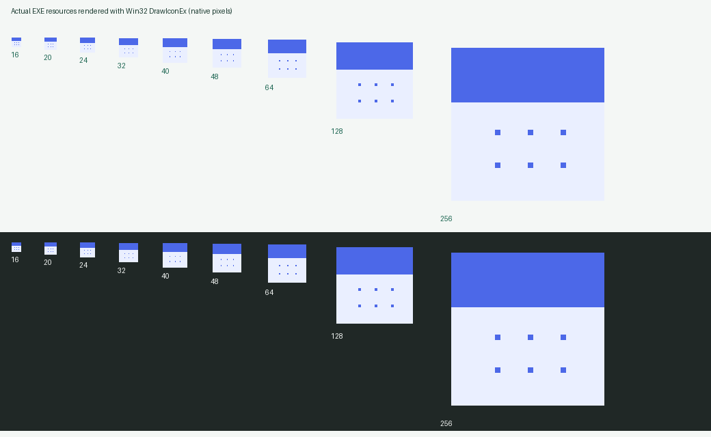
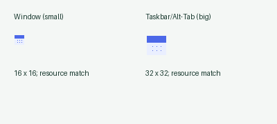
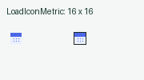

# v0.5.0 verification

Verified on Windows with Rust 1.96.1:

- A full compact redesign with Windows Segoe UI typography based on Multi-Monitor Brightness: 13 px body text, 12 px buttons, a full-width workspace without a sidebar, inline summary, and aligned subscription columns. At 1000 × 760, ten complete records are visible in Compact mode with twelve demo records loaded.
- Separate General, AI provider, Notifications, Google Drive, and Storage & updates tabs; Light, Dark, and System appearance; and saved Compact, Standard, and Large subscription sizes. Real frame captures cover the table, all five Settings tabs, image import, and the editor. The three row sizes were captured from saved settings in isolated demo stores; theme/density switching through a physical mouse is not part of this verification.
- The image-import screen was exercised with an actual inline-image request to a deterministic local HTTP fixture returning three demonstration records. The current README import image comes from that real UI capture. No external AI request was made for the redesign captures, and the fixture is not evidence of live vision recognition.
- All three desktop regressions passed against the final v0.5.0 packaged EXE with twelve demo records and eight frame captures. The final visible sample measured 8.20% of one CPU core while window input events were arriving, so it is not an idle measurement. Hidden and restored samples measured 0.00%; the injected pointer-event workload measured 5.60%. Frame tracing confirmed unchanged-scene skips. Perceptual smoothness was confirmed by the user for v0.4.2; the v0.5.0 redesign has not yet had a separate user assessment.

- Release compilation with a statically linked MSVC runtime; the packaged executable imports only Windows system DLLs.
- Unit tests for reminder lead times, overdue catch-up, paused subscriptions, month-end and leap-year renewal, and daily per-channel deduplication.
- Storage tests for save/reopen, backups, invalid JSON preservation, external change rejection, missing synced data, and switching data folders.
- Stable release asset selection, semantic version comparison, official download URL checks, and checksum parsing.
- Windows DPAPI token encryption/decryption and rejection of invalid protected data.
- Compatible Chat Completions HTTP requests with bearer authentication and inline images, model listing, and redirect blocking.
- Parsing of multiple detected records, original-language names, incomplete model responses, and missing expiry dates.
- Atomic import validation, persistence, and exact-duplicate skipping.
- Google OAuth PKCE against the RFC test vector, callback state and duplicate-parameter rejection, split HTTP callback headers on a nonblocking Windows listener, Desktop client configuration validation, token refresh/rotation, permission checks, and revoked-session handling using local HTTP fixtures.
- Google Drive app-data request scoping, pagination, download validation, deterministic upload IDs, multipart create/media update requests, and expired-access-token handling using local HTTP fixtures.
- Two-device replication simulations for independent offline edits, concurrent conflicts and resolution, deletions, lost upload responses, and edits made while a download is in flight.
- Formatting and Clippy checks.
- All 37 tests with no bundled configuration and with the Desktop JSON supplied through the build environment; a required release build without configuration is rejected without logging configuration values.
- An interactive launch of the packaged application with isolated sample data, dashboard rendering, opening Settings, and exiting through Quit.
- In v0.2.0, a live request from the packaged image importer to an authenticated AI-Hub Universal endpoint correctly recognized three demonstration subscriptions with their dates, prices, and currencies. The response also identified the overdue subscription.
- Real application frame captures of the dashboard, Settings, lower settings, Google Drive setup, and image import view, without operating-system cursor overlays.
- A comparative isolated visible-idle sample after 18 seconds of settling: v0.4.0 used 68.88% of one CPU core over four seconds; v0.4.1 used 0.00%. The originally reported user process also showed 97–99% of one core on its main thread, with negligible GPU use. A three-second hidden-window sample of v0.4.1 measured 0.00% of a core.
- Interactive v0.4.1 checks for Settings navigation, hide-on-close with Alt+F4, same-PID restoration by duplicate launch from hidden and minimized states, duplicate-launch opening after background startup, and visible Quit. Restored windows were actually inspected; foreground focus during concurrent user activity was not established.
- v0.4.2 replaces the GPU host with CPU rasterization and Windows GDI presentation. The packaged process loaded `gdi32.dll` and `gdi32full.dll`, with no matching OpenGL, NVIDIA OpenGL, DXGI, Direct3D, Vulkan, EGL, or GLES modules. The Windows dependency tree contains no eframe, glow, or wgpu renderer.
- All three opt-in desktop regressions passed against `dist/SubscriptionsReminder-v0.4.2.exe`: real HWND hide/restore cycles through tray single/double-click callbacks, Open/Quit command dispatch, minimized restoration, background startup, duplicate launch, and hidden shutdown. A background-started process also produced all five actual CPU-rendered screenshots after restoration, preserving initial font uploads. Dashboard, Settings, and Google Drive captures were visually inspected for text, colors, and clipping.
- With three demo subscriptions, a four-second visible-idle sample after 18 seconds of settling measured 0.00% of one CPU core. A four-second hidden sample measured 0.00%. The restored sample measured 14.06% while input was arriving, so it is excluded from the idle comparison. A separate 120-event pointer-movement workload measured 12.84% of one core.
- The opt-in trace recorded a 27.924-second gap between visible UI passes across approximately 22 seconds of visible waiting and six seconds hidden. Across the complete mixed idle/restore/pointer test, 242 visible UI passes resulted in 70 rasterized frames; 172 unchanged scenes skipped rasterization and presentation. The removed 15-second heartbeat did not produce an idle frame. Timed waits still support input, animations, screenshots, and local-midnight date refresh; background changes explicitly wake the UI.
- The account owner tested the normal v0.4.2 process with their settings and confirmed that the cursor and Windows were smooth, including the hide/reopen scenario. This confirms the reported perceptual improvement on this machine; the short measurements are not a guarantee of zero CPU use or universal hardware performance.

All 37 unit tests and three opt-in desktop integration tests pass, with formatting and Clippy checks. Unit coverage includes validation of the bundled Desktop client, persistence of a session's original client across updates, and detection of external data changes without waking the UI for unchanged data. OAuth configuration is excluded from Git and provided through an ignored local file or a build environment variable. The maintainer's Google Cloud project now has Drive API enabled, the app-data scope configured, and the account owner registered as a test user. Browser sign-in and a real cloud round-trip are still pending account-owner verification. OpenRouter uses the documented image-input protocol and the client was exercised against local HTTP fixtures; a paid OpenRouter call was not made. Google requests were tested against HTTP fixtures and a multi-device simulator, **not a real Google account**. The following remain unverified and should be checked manually:

- A complete physical tray mouse/menu test for every action, including hidden Quit. Native callback/command regression coverage and user-confirmed smoothness are recorded separately above.
- Visible Windows notification delivery and continuing reminders while hidden.
- Real Telegram delivery with user-supplied bot credentials.
- Actual Google browser sign-in, consent, session refresh, and Drive synchronization across computers. The bundled project remains in Testing, so only registered test users can sign in and Google may require reconnection after seven days.
- Downloading, replacing the installed executable, and restarting through the updater. Version/asset/checksum logic is covered by tests; the full installation flow is not yet verified against a newer published release.

No Telegram credentials or real subscription data were used during verification. The private AI-Hub credential was used with explicit user authorization, kept outside the repository, and stored with Windows DPAPI encryption. README images contain demonstration data only.

## Shared updater and rendering audit (2026-11-01)

Reusable release discovery, HTTPS/download progress, checksum/PE verification and installation/rollback now live in the sibling `rust-auto-updator` core. The product adapter keeps the saved startup preference, the Updates section, historical single-EXE and `-x64` selection, and the exact data-directory restart arguments. The new helper/cleanup routes run before the normal window startup. The previous released updater uses its own old executable as its helper, so installing the migrated executable does not require the new protocol in that older helper.

The application ICO now contains native 16/20/24/32/40/48/64/128/256 px images with proper alpha and AND masks. Window and taskbar icons load those resources at the window DPI; the tray loads the small native metric with `LoadIconMetric`. Small icons retain the calendar artwork with 14×14 visible bounds in the 16px image.

Background repaint wakeups previously reached egui layout before the hidden-window raster check. Hidden/minimized/zero-area windows now stop before UI construction; callbacks still dispatch quit and native restore. Cached OS repaint blits are also blocked while hidden. The event loop waits on actual repaint/diagnostic deadlines and explicitly wakes the final Win32 wait on exit.

Formatting, all-target Clippy, and 38 Rust regressions passed. Three existing desktop tests that inject OS messages were intentionally left ignored. The first sandbox test run could not use localhost fixtures or persist files in sandbox TEMP; the complete successful rerun used isolated repository `.qa/temp` and localhost-capable execution. No personal Google/AI/Telegram service was contacted by those synthetic fixtures.

The finite `--diagnostics` mode requires explicit `--demo --data-dir`; it disables external input, skips the taskbar and exits after sampling. `scripts/Check-Rendering.py` checks actual layouts/rasters/presents and process CPU for settled visible, minimized, restored and hidden intervals. It does not establish input latency, tray clicks, mixed-monitor behavior or compositor/GPU telemetry.

The final optimized diagnostic (PID **31616**, normal-shell execution after sandbox tray registration was rejected) passed: visible idle **5.00 s**, minimized **2.00 s**, restored idle **3.00 s** and hidden **2.00 s** each had **0 layouts, 0 rasters, 0 presents**, and no measurable process CPU-time increase. CPU values are quantized by Windows process-time resolution, rather than a claim of physically zero work. Minimized and hidden intervals each received a deliberately requested background repaint wake and skipped all UI work; restore generated two useful frames before settling. The process exited automatically. Source tracing and the native runtime module query agree on the CPU software rasterizer and Win32 GDI; selected GPU render modules were absent. GPU/compositor telemetry and real input/tray interactions were not measured.

The application now explicitly activates common-controls v6 before importing `LoadIconMetric`; otherwise its native icon-loading path can fail before normal startup. Sandbox execution separately could not register a tray icon, while normal-shell diagnostic startup passed the same required registration path. No diagnostic suppression or fake successful tray startup was added.

All nine final EXE icon resources were decoded, checked for nonblank alpha/transparency and native dimensions, and rendered with Win32 on light/dark backgrounds. The actual window returned **16×16** and **32×32** icon handles matching those resources. The same production `LoadIconMetric` call loaded a native **16×16** tray-resource handle. These images prove resources and assignments, not OS tray/taskbar appearance or clicks.

